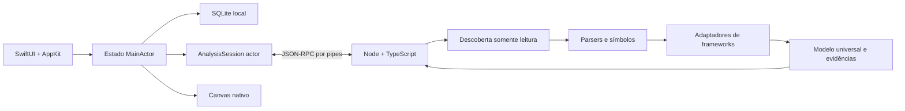

# Arquitetura — Endpoint Mapper

Status: baseline da Fase 0, 19/10/2026. Produto em desenvolvimento, sem frameworks suportados ainda.

## Avaliação e decisões

SwiftUI + AppKit + Foundation Process é uma composição viável para uma interface nativa e um motor isolado do ciclo de renderização. A prova local executa Swift → Node incorporado → JSON-RPC. Ela não valida sandbox, notarização ou a interface final.

macOS mínimo: 14.0. NavigationSplitView, Canvas, Swift Concurrency, Settings e AppKit atendem ao desenho sem depender de APIs mais recentes. Compilar com deployment target 14 não substitui testes em Sonoma. SQLite será acessado pela biblioteca do sistema, com migrações transacionais versionadas.

A aplicação terá estado de apresentação no MainActor. Um actor AnalysisSession gerenciará processo, requisições pendentes e leitura incremental. Views não interpretarão AST nem resolverão rotas. O motor terá descoberta → parsing → adaptadores → resolução → normalização → diagnósticos/documentação. TypeScript Compiler API será o parser JS/TS; Tree-sitter será incorporado por linguagem quando os adaptadores correspondentes começarem, com gramáticas e licenças fixadas por versão.



## Estrutura final planejada

Pastas são criadas à medida que recebem implementação; não constituem recursos entregues.

```text
macos/
  EndpointMapper.xcodeproj
  App/ Core/ Models/ Services/ ViewModels/ Features/
  Components/ DesignSystem/ GraphRendering/ AnalysisBridge/
  Persistence/ Resources/{Branding,Fonts,Assets.xcassets}/ Tests/
engine/
  src/{core,discovery,parsers,adapters,framework-detectors,
       symbol-resolution,dependency-graph,normalizers,diagnostics,
       documentation,cache,protocol,utilities}/
  tests/ fixtures/
shared/protocol/
packaging/{scripts,dmg,configuration}/
branding/original-logo/
docs/{architecture,development,distribution,decisions}/
```

## Modelo universal

Project: id UUID persistente, caminho autorizado, bookmark quando aplicável, nome de exibição, serviços. Service: id, raiz relativa e evidências de framework. Analysis: id, projectId, schemaVersion, engineVersion, adapterVersions, timestamps, estado e diagnósticos.

Endpoint: id, serviceId, método, caminho resolvido opcional, caminho declarado, handler opcional, controller opcional, framework, linguagem, source, prefixos, middlewareRefs, dependencyRefs, parâmetros, requestBody, responses, autenticação/autorização, evidências, confiança, limitações. Ausência de dados é null/coleção vazia acompanhada de diagnóstico; não é um schema inventado. Métodos são enumerados, incluindo ALL quando demonstrável.

SourceReference: arquivo relativo à raiz autorizada, intervalo de bytes, linha e coluna começando em 1, hash do arquivo. Evidence: source, regra do adaptador, confiança confirmed/inferred/unresolved. Não persistir fonte completa por padrão.

GraphNode: id, kind, label, source opcional. Tipos: Project, Service, Module, Endpoint, Controller, Handler, Middleware, Function, Class, Repository, File, ExternalDependency. GraphEdge: id, from, to, kind, evidence[], confidence. Relações: defines, handles, calls, imports, depends_on, uses_middleware, belongs_to, references.

IDs determinísticos usam hash de serviceId + arquivo relativo + identidade semântica + discriminador de ocorrência. Não usar apenas números de linha. Alterações de identidade requerem comparação heurística explicitamente rotulada; IDs não garantem acompanhar renomes.

## Segurança

Escolha inicial: distribuição direta local, sem App Sandbox declarado. Acesso limitado logicamente às raízes escolhidas; isso não equivale a isolamento imposto pelo SO. Resolver realpath e validar contenção antes de leituras; inicialmente ignorar symlinks. Não carregar módulos/configurações do projeto via require/import, não rodar scripts, não instalar dependências do alvo. Cancelamento e limites devem existir antes de analisar projetos grandes.

Processo iniciado por URL absoluta interna ao bundle, argumentos fixos e ambiente mínimo: não herdar NODE_OPTIONS, NODE_PATH, DYLD_* nem diretório de trabalho do projeto. Não abrir portas. A prova atual nem recebe caminhos de projetos.

Planejar limites por arquivo, total de arquivos, bytes totais, profundidade e memória; relatar omissões. Verificar hash/identidade de arquivos entre análise e exibição. Logs locais devem omitir fonte e segredos. Exportação apenas mediante ação do usuário.

## Riscos e mitigação

| Risco | Resposta e gate |
|---|---|
| Node e addons por arquitetura | Builds separados x64/arm64; inspecionar dependências; teste nativo em ambos antes de universal |
| Sandbox e bookmarks entre processos | Spike próprio; não anunciar App Sandbox com apenas acesso lógico |
| Assinatura e JIT | Assinar auxiliares primeiro; avaliar entitlements mínimos do Node; testar Hardened Runtime antes de distribuição |
| Rotas dinâmicas | unresolved + evidência; nunca resolver executando projeto |
| Grandes grafos | Índices, agrupamento e viewport culling; benchmark antes de metas |
| Protocolo volumoso | Framing limitado, batches, backpressure, timeouts e reinício explícito |
| Licenças | Preservar avisos Node, fontes e parsers; não escolher licença do código/brand pelo proprietário |
| Falsa indicação de suporte | Matriz de capacidades sustentada por fixtures e testes |

Fontes técnicas: [Foundation Process](https://developer.apple.com/documentation/foundation/process), [Node process](https://nodejs.org/api/process.html), [Node CLI e ambiente](https://nodejs.org/api/cli.html), [JetBrains Mono](https://www.jetbrains.com/lp/mono/).
